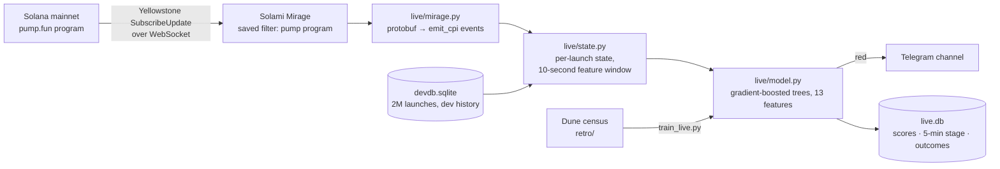

# ClusterPulse

**A 10-second trap-risk score for every pump.fun launch, streamed live from Solana through Solami Mirage.**

About 43,000 tokens launch on pump.fun every day (Dune, 19.09–08.10.2026). Most rugs give themselves away in the first block: a bundle that grabs a third of the supply, a dev who shipped twelve tokens this month, a launch in mayhem mode. Terminals already show bundle % and dev history as raw numbers. Nobody can read those numbers for 43k launches a day, and none of them answers the question a trader actually has: *how likely am I to get wrecked if I buy this?*

ClusterPulse answers that question. It watches the pump.fun program in real time and scores each launch about 12 seconds after creation. When a launch scores red, a Telegram alert goes out with the reasons and the historical trap rate behind each one.

```text
🔴 $TICKER — trap risk 27% (market base 4%)
├ dev bought 46% of supply in the first block — 12% of such launches were traps
├ dev launched 14 tokens in 30 days — 9% of such launches were traps
├ scored 12 s after creation · source: Solami Mirage
└ https://pump.fun/coin/<mint>
```

Live channel: **[t.me/cluster_solana](https://t.me/cluster_solana)** · Demo video: **TODO** · Built for Colosseum Crypto World's Fair (Solana track) and the Solami sidetrack.

## Does it work? Held-out backtest

The model was trained on weeks 1–3 of a full pump.fun census pulled from Dune (19.08–18.09.2026), with a 3-day gap, and scored on week 4, which it never saw.

| Level | Launches | Trap rate | vs base | Retail SOL in | Retail ROI | Lost per 1 SOL |
|---|---:|---:|---:|---:|---:|---:|
| 🔴 red (top 2%) | 1,381 | 29.4% | 6.9× | 77,414 | −32.9% | 0.33 SOL |
| 🟡 yellow (next 8%) | 5,522 | 15.3% | 3.6× | 84,499 | −19.5% | 0.19 SOL |
| 🟢 green (rest) | 62,126 | 2.7% | 0.6× | 2,385,613 | −11.6% | 0.12 SOL |

69,029 launches with at least 1 SOL of retail money. AUC 0.866, stable across weeks (0.869 / 0.873 / 0.866). Generated by `python tools/backtest_table.py` from `model/live_model.json`.

**Trap** means retail (non-dev wallets that first bought after slot 5, high-frequency bots excluded) lost more than half of its SOL on a token that never graduated.

How to read the table:
- Red is a *don't touch / size down* filter, not a short signal. 71% of red launches are not traps.
- Even green launches lose retail money on average. Pump.fun is negative-sum for late buyers. The score tells you where the losses are concentrated, not where the profit is.
- A live backtest from the 24/7 scorer runs alongside: `python live_report.py`.

## What we learned (and why the name is half wrong)

We started as a wallet-cluster detector. The data disagreed:

- **Counting wallets in one transaction barely predicts traps by money.** Inside non-mayhem launches it gives 1.3× the base.
- **Bundles measured by volume do.** Non-dev wallets taking more than 30% of supply in the first block gives 4.5×.
- **Clusters do hurt small wallets.** On the label "most retail wallets lost more than half", multi-wallet transactions give 2.3× and 3+ wallets in one transaction give 2.75×. Bundles hit many small buyers more than they drain the big ones.

So the product is the risk score. Cluster and bundle signals are its explanations. Numbers: `model/fork_a.txt`.

## How it works



1. **Stream.** A Solami Mirage subscription filters the chain to transactions that touch the pump.fun program. Frames arrive as binary Yellowstone `SubscribeUpdate` over a plain WebSocket.
2. **Decode.** `live/mirage.py` reads the protobuf by hand, without protoc or generated code. It pulls the pump.fun `CreateEvent`, `TradeEvent` and `CompleteEvent` out of the `emit_cpi` inner instructions and resolves address-lookup-table accounts.
3. **Features.** For each launch: first-block supply split between dev and others, buyers and multi-wallet transactions in slots 0–5, net supply bought in 10 s, the dev's launches and graduations over 30 days, same-ticker launches in the last 30 minutes, and mayhem mode. Every definition mirrors the Dune SQL the model was trained on (`retro/census.sql`), so live inputs match training inputs.
4. **Score.** A HistGradientBoosting model, exported to JSON and evaluated in pure Python, with no sklearn in production. Red is the top 2% of scores, yellow the next 8%.
5. **Outcome.** Every launch is followed until it goes quiet. Graduation, retail SOL in and out, and the dev's PnL are stored, so the live backtest builds itself. Every red alert in the channel then gets a reply with what actually happened (retail in/out, graduated or not, dev PnL, trap or not), so anyone can check the calls, misses included.

### Why Solami Mirage

The first version used `logsSubscribe`. Busy pump.fun transactions can exceed the log limit and arrive as `Log truncated`, with the events cut off. In our recorded mainnet sample that happened to 0.7% of transactions. Every such transaction needed a `getTransaction` refetch, which costs seconds and RPC credits, exactly where the 10-second window is tight. Mirage delivers the whole transaction, inner instructions included, so the events are never truncated and nothing needs refetching. The filter lives on Solami's side, and the client is just a WebSocket.

Mirage is the default source whenever `SOLAMI_API_KEY` is set. If the internet drops, the scorer keeps reconnecting to Mirage and marks the gap. If Solami rejects the key (a trial ended, say), it falls back to `logsSubscribe` (Solami WebSocket or Helius) with refetch.

Measured on mainnet (`tools/solami_check.py`, 40 s, 10.10.2026): 2,540 pump.fun transactions (about 63 per second) carried 1,932 events, including 20 launches. The first frame arrived 0.4 s after connecting, and the median lag from block time to decoded event was 1.8 s. Block time only has whole-second resolution, so this number is rough.

`tests/test_mirage.py` replays a recorded mainnet stream through both paths. 6,712 transactions decode to identical events, and the full scorer produces identical scores.

## Quick start

```bash
pip install -r requirements.txt
cp .env.example .env          # then fill it in, see below
python tools/solami_check.py  # key, RPC, Mirage subscription, 30 s of live pump events
python live_scorer.py         # live: Mirage if SOLAMI_API_KEY is set, else logsSubscribe
```

| Variable | Needed for | Notes |
|---|---|---|
| `SOLAMI_API_KEY` | Mirage stream (default source), Solami WS/RPC | Standard key with MirageStream + MirageManage (+ DataApi). WebSocket and Mirage are not on Solami's Free plan |
| `SOLAMI_MIRAGE_ID` | optional | Use an existing Mirage subscription instead of creating `clusterpulse-pump` |
| `HELIUS_API_KEY` | fallback source | Used when Solami is not configured or unreachable |
| `WS_URL`, `RPC_URL` | optional | Any other Solana WebSocket / RPC for the `logsSubscribe` path |
| `TG_BOT_TOKEN`, `TG_CHAT_ID` | alerts | Bot must be an admin of the channel; `TG_CHAT_ID=@channel` works for public channels |
| `ALERT_LANG` | optional | `en` (default) or `ru` |
| `DECIDE_AFTER` | optional | Seconds after creation before scoring (default 12: 10-s window plus confirmation lag) |
| `MIN_WALLETS_ALERT` | optional | Minimum wallets in 10 s before a red launch goes to Telegram (default 3) |
| `DUNE_API_KEY` | retraining only | Census queries in `retro/` |

**Dev history.** `python -m live.devdb --seed` builds `devdb.sqlite` from Dune census exports (`retro/census_run.py`), and `--append` closes gaps (`retro/devgap.sql`). Without it the scorer still runs, but the dev-history features stay empty until it has watched launches for a while.

**Running 24/7.** On Windows, `4_SCORER_24x7.bat` restarts the scorer on exit and writes daily logs. On Linux, use `deploy/clusterpulse-scorer.service` (systemd, `Restart=always`).

**Offline.**

```bash
python tests/test_live.py                       # synthetic events → decoder → features → score
python tests/test_mirage.py                     # Mirage decoder vs logs on a recorded stream
python live_scorer.py --record raw.jsonl        # record raw messages (frames in Mirage mode)
python live_scorer.py --replay raw.jsonl        # replay without network, into replay/live.db
python live_report.py                           # live levels vs outcomes from live.db
```

## Retraining

```bash
python retro/census_run.py 2026-08-19 2026-09-18   # Dune census, one CSV per day (needs DUNE_API_KEY)
python retro/train_live.py                         # weekly AUC, holdout, thresholds -> model/live_model_new.json
python tools/backtest_table.py                     # held-out table -> model/backtest.md
```

`retro/dq.py` wraps the Dune API with a per-run credit budget. `--submit` and `--collect` handle shells that can't wait for long queries.

## Repository layout

| Path | What |
|---|---|
| `live_scorer.py` | Live scorer: stream, timers, alerts, SQLite |
| `live/` | `mirage.py` (Solami Mirage), `pump_events.py` (pump.fun IDL decoding), `state.py` (features), `model.py` (inference), `devdb.py` (dev history) |
| `retro/` | Dune SQL and the training pipeline |
| `model/` | Production model, held-out backtest, fork-A analysis |
| `tools/` | Solami smoke test, backtest table |
| `tests/` | Offline tests |
| `legacy/` | Pre-hackathon code (see below) |
| `docs/archive/` | Early concept documents. Their latency and architecture claims are outdated |

## Limitations and roadmap

- **AMM phase is not tracked.** A token that graduates counts as "not a trap", even if it dumps on the AMM afterwards.
- **pump.fun only, SOL-quoted launches only.** Other launchpads (Meteora DBC, LaunchLab) are next.
- **Research, not yet in production:** a wallet *organicity index* (how much of a buyer's balance went through real price risk in the last 30 days) and funding-graph links (common funder, synchronized top-ups). They may matter more for anti-sybil filtering than for rug prediction.
- **Next:** a second-stage alert at 5 minutes, a JSON/WebSocket feed for trading bots, and on-chain score attestations that any program can read.

## Prior work disclosure

`legacy/` holds code written before the hackathon (April 2026): a pump.fun collector, a dev-history scanner and a Google-Sheets scorer for finding *good* devs. Everything else was built during Colosseum Crypto World's Fair (from 14.09.2026): the live scorer, the Mirage transport, the pump.fun event decoder, the Dune census and training pipeline, the model, the tests and the tools.
